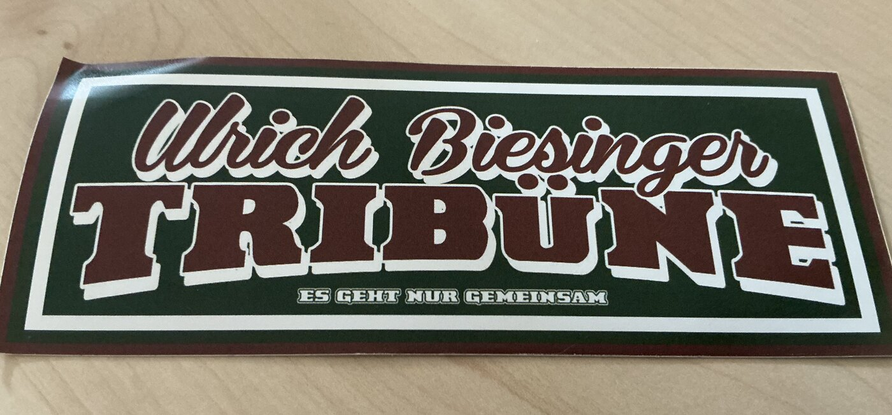
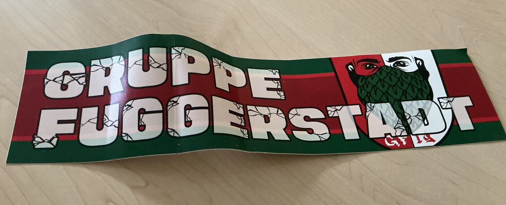
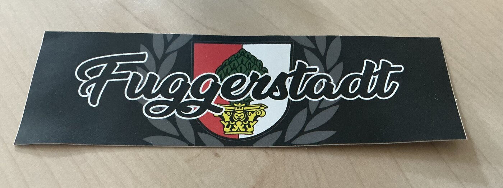
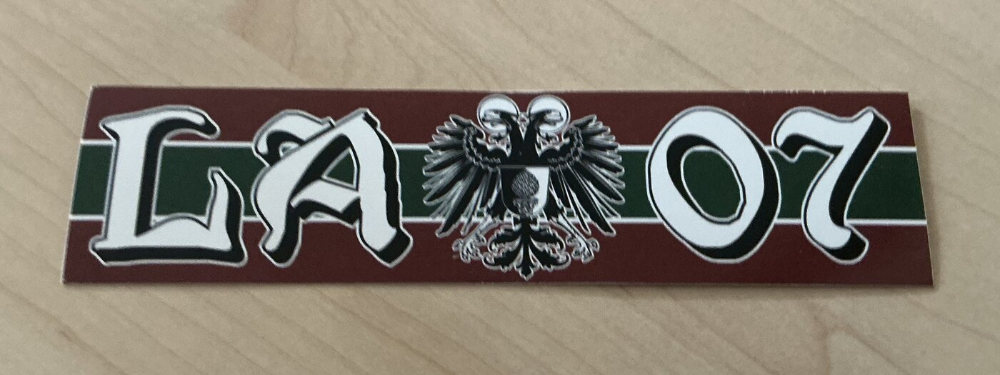
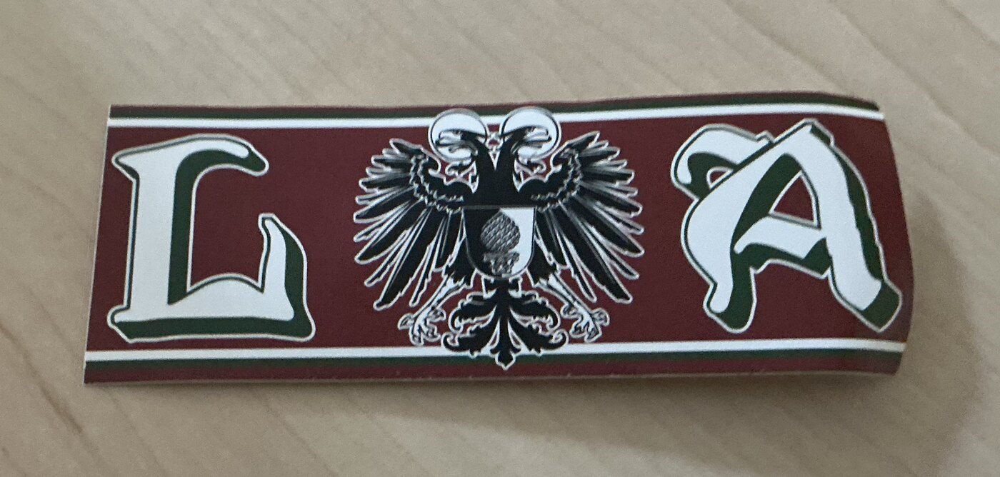

# Yamal's Stickers AUX – Augsburg & FCA Sticker-Verkauf (Preis VB)

Offizielle **GitHub Pages Website** für den Verkauf von originalen **Augsburg (0821 / AUX)** & **FCA** Szene- und Kurven-Stickern in **Rot – Grün – Weiß**.

Alle angebotenen Aufkleber sind einzeln, mehrfach oder im Set erhältlich – **jeder Preis ist frei verhandelbar (VB)!** Keine Platzhalter, keine Demo-Artikel: Alle Bilder zeigen die echten, verfügbaren Sticker.

---

## Inhaltsverzeichnis

1. [Verfügbare Original-Sticker (Preis VB)](#1-verfügbare-original-sticker-preis-vb)
2. [Verkaufskonditionen & Treffpunkt Augsburg (Keine Lieferung)](#2-verkaufskonditionen--treffpunkt-augsburg-keine-lieferung)
3. [Komplettes GitHub Pages Setup (Schritt-für-Schritt)](#3-komplettes-github-pages-setup-schritt-für-schritt)
4. [Website lokal auf dem eigenen Rechner testen](#4-website-lokal-auf-dem-eigenen-rechner-testen)
5. [Projektstruktur](#5-projektstruktur)
6. [Neue Sticker-Fotos hinzufügen oder Texte ändern](#6-neue-sticker-fotos-hinzufügen-oder-texte-ändern)

---

## 1. Verfügbare Original-Sticker (Preis VB)

### 1. Ulrich-Biesinger-Tribüne – „Es geht nur gemeinsam“

- **Optik:** Dunkelgrün, Weinrot und Weiß mit umlaufendem Doppelrahmen
- **Preis:** Verhandelbar (VB)

### 2. Gruppe Fuggerstadt (GF19)

- **Optik:** Breiter Rot-Grün-Weißer Streifenkleber mit Riss-Schriftzug und Zirbelnuss-Wappenmotiv
- **Preis:** Verhandelbar (VB)

### 3. Fuggerstadt – Stadtwappen & Lorbeerkranz

- **Optik:** Tiefschwarzer Streifen-Sticker mit Augsburger Zirbelnuss-Stadtwappen im Lorbeerkranz
- **Preis:** Verhandelbar (VB)

### 4. LA 07 – Doppeladler & Zirbelnuss

- **Optik:** Weinrot-Grün-Weißer Streifen mit „LA 07“-Schriftzug und Doppeladler inkl. Zirbelnuss-Brustschild
- **Preis:** Verhandelbar (VB)

### 5. L A – Doppeladler Klassik

- **Optik:** Kompakter weinroter Streifen-Aufkleber mit grün-weißer Kante und zentralem Doppeladler
- **Preis:** Verhandelbar (VB)

---

## 2. Verkaufskonditionen & Treffpunkt Augsburg (Keine Lieferung)

- **100 % Verhandlungsbasis (VB):** Auf der Website können Interessenten ihre gewünschten Motive bequem per **Schnellauswahl (`−30`, `−10`, `−1` sowie `+1`, `+10`, `+30`)** anklicken, ihren **eigenen Wunschpreis (€ VB)** eintragen und die fertige Anfrage direkt kopieren oder in WhatsApp öffnen.
- **Nur Treffpunkt in Augsburg:** Persönliche Direktübergabe vor Ort in Augsburg – z. B. an **FCA-Heimspieltagen an der Arena**, in der **Augsburger Innenstadt / Königsplatz**, am **Augsburger Hauptbahnhof** oder nach kurzer Absprache in Augsburg.
- **Keine Lieferung / Kein Versand:** Es erfolgt ausschließlich eine persönliche Übergabe am Treffpunkt in Augsburg (kein Postversand, keine Lieferung).
- **Tausch:** Tauschangebote gegen andere Augsburg- / FCA-Sticker beim Treffen in Augsburg sind jederzeit willkommen.

---

## 3. Komplettes GitHub Pages Setup (Schritt-für-Schritt)

Dieses Repository ist vollständig als **statische GitHub Pages Website** aufgebaut (inklusive `.nojekyll`, relativer Dateipfade für Unterverzeichnisse und fertigem GitHub-Actions-Workflow unter `.github/workflows/pages.yml`).

### Schritt 1: Änderungen in den `main`-Branch übernehmen
Stelle sicher, dass der aktuelle Arbeitsstand per Pull Request in den Branch `main` gemergt wurde.

### Schritt 2: GitHub Pages in den Repository-Einstellungen aktivieren
1. Öffne dein Repository auf GitHub: `https://github.com/tegmaram/Yamalsstcikersaux`
2. Klicke oben rechts auf **Settings** (Einstellungen).
3. Wähle in der linken Seitenleiste unter *Code and automation* den Punkt **Pages**.
4. Unter **Build and deployment → Source** hast du zwei Möglichkeiten (beide werden vollständig unterstützt):
   - **Variante A (Empfohlen – GitHub Actions):** Wähle **GitHub Actions** aus. Die enthaltene Datei `.github/workflows/pages.yml` veröffentlicht die Seite bei jedem Push auf `main` vollautomatisch.
   - **Variante B (Direkt vom Branch):** Wähle **Deploy from a branch**, setze den Branch auf **`main`** und den Ordner auf **`/ (root)`**, und klicke auf **Save**.

### Schritt 3: Fertige Live-Website aufrufen
Nach ca. 30–60 Sekunden ist deine Sticker-Verkaufsseite dauerhaft und kostenlos erreichbar unter:

```text
https://tegmaram.github.io/Yamalsstcikersaux/
```

---

## 4. Website lokal auf dem eigenen Rechner testen

Da es sich um eine reine HTML/CSS/JavaScript-Website ohne Build-Zwang handelt, kannst du sie auf jedem Computer sofort starten:

### Repository klonen
```bash
git clone https://github.com/tegmaram/Yamalsstcikersaux.git
cd Yamalsstcikersaux
```

### Lokalen Webserver starten (optional für Live-Vorschau)
Mit Python (auf macOS & Linux vorinstalliert):
```bash
python3 -m http.server 3000 --bind 0.0.0.0
```
Oder alternativ mit Node.js (`npx`):
```bash
npx --yes serve -l 3000 .
```

Danach im Browser öffnen:
```text
http://localhost:3000
```

---

## 5. Projektstruktur

```text
Yamalsstcikersaux/
├── .github/
│   └── workflows/
│       └── pages.yml                         # Automatisches GitHub Pages Deployment
├── assets/
│   └── stickers/                             # Originale Sticker-Produktfotos (optimiert)
│       ├── fuggerstadt-wappen.jpg            # Motiv: Fuggerstadt Stadtwappen
│       ├── gruppe-fuggerstadt.jpg            # Motiv: Gruppe Fuggerstadt (GF19)
│       ├── la-07-adler.jpg                   # Motiv: LA 07 Doppeladler
│       ├── la-adler.jpg                      # Motiv: L A Doppeladler Klassik
│       └── ulrich-biesinger-tribuene.jpg     # Motiv: Ulrich-Biesinger-Tribüne
├── .gitignore                                # Ignoriert temporäre Systemdateien
├── .nojekyll                                 # Deaktiviert Jekyll auf GitHub Pages
├── README.md                                 # Komplette deutsche Anleitung & Dokumentation
├── index.html                                # Hauptseite (Augsburg & FCA Sticker-Verkauf)
├── styles.css                                # Responsives Design in Rot-Grün-Weiß
└── app.js                                    # Sticker-Auswahl, Lightbox & VB-Anfrage-Generator
```

---

## 6. Neue Sticker-Fotos hinzufügen oder Texte ändern

Wenn du später weitere Sticker verkaufen möchtest, geht das in zwei einfachen Schritten:

1. **Foto ablegen:** Speichere das neue Sticker-Foto (am besten im `.jpg`- oder `.png`-Format) im Ordner `assets/stickers/`, z. B. `assets/stickers/neues-motiv.jpg`.
2. **In `app.js` eintragen:** Öffne die Datei `app.js` und ergänze im Array `STICKERS` ganz oben einen neuen Eintrag:
   ```js
   {
     id: 'neues-motiv',
     title: 'Name des Stickers',
     tag: 'Kategorie',
     image: './assets/stickers/neues-motiv.jpg',
     description: 'Kurze Beschreibung zum Aufkleber.'
   }
   ```
3. **Commit & Push:** Sobald du die Änderung auf GitHub hochlädst, aktualisiert sich deine GitHub Pages Website automatisch.

---

**Augsburg • FCA • Rot-Grün-Weiß – Alle Preise auf Verhandlungsbasis (VB)!**
